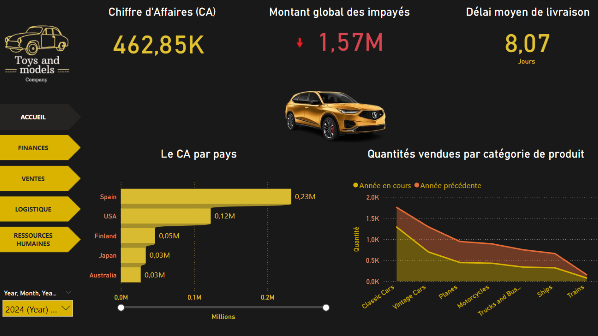
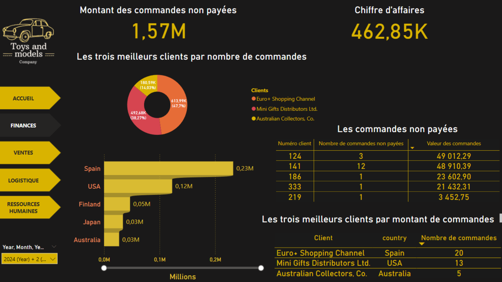
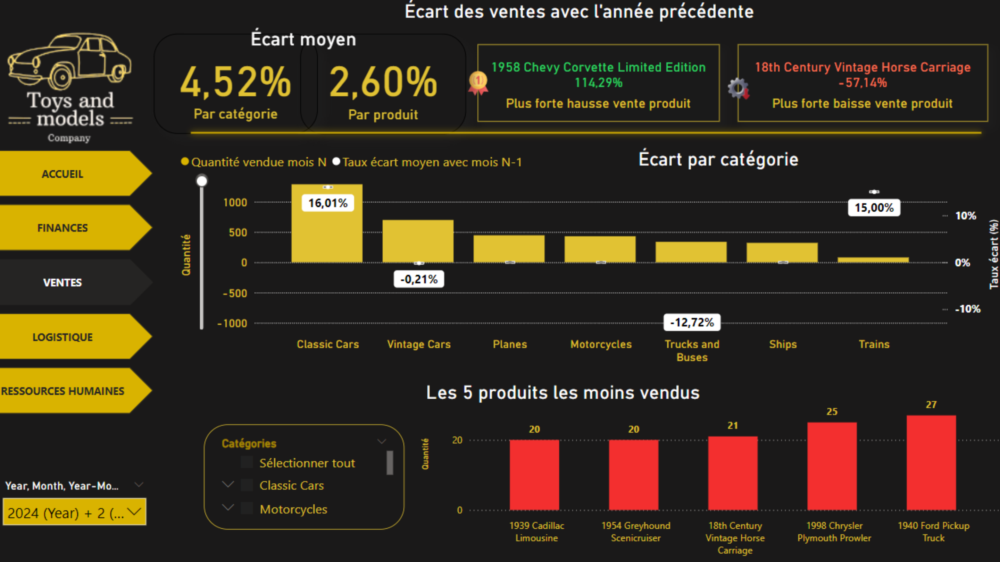
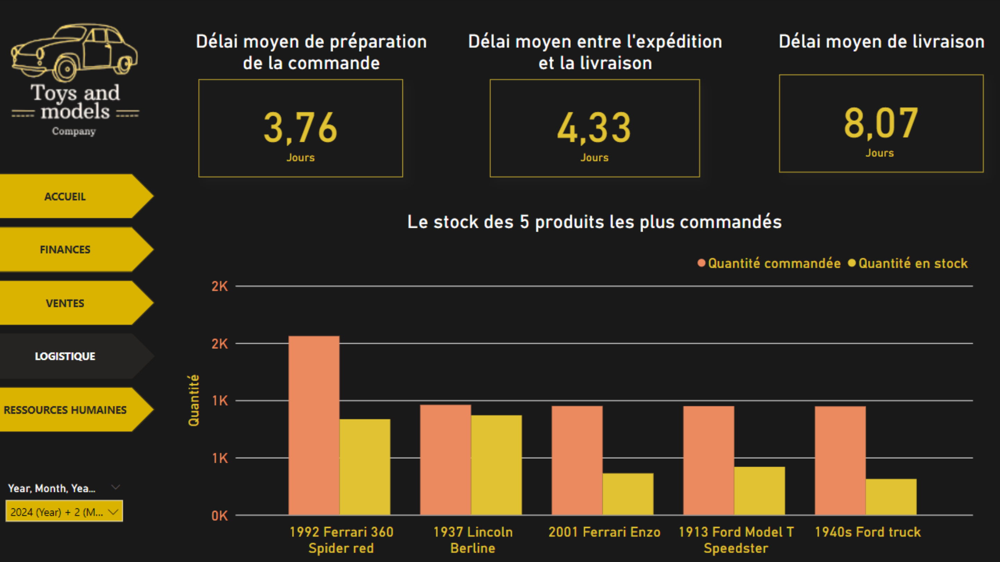
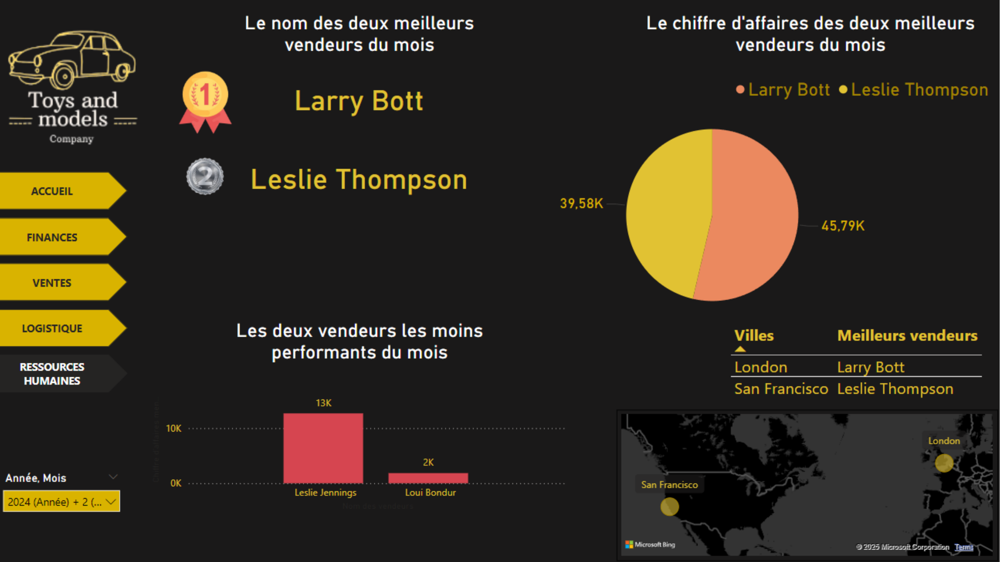

# Analyse globale des activités d'une entreprise

Dashboard Power BI fictif réalisé pour le directeur d'une entreprise de jouets et de modèles réduits ("Toys and Models Company"), permettant de suivre en un coup d'œil le chiffre d'affaires, les finances, les ventes, la logistique et les ressources humaines. Données modélisées et préparées en SQL, visualisations construites sous Power BI.

**Outils utilisés** : SQL, Power BI

---

## 💰 Finances
Suivi des commandes non payées et des meilleurs clients :
- montant des commandes non payées (1,57M) et chiffre d'affaires global (462,85K)
- top 3 des clients par montant de commandes
- détail des commandes impayées

---

## 📊 Ventes
Analyse de l'écart des ventes par rapport à l'année précédente :
- écart moyen par catégorie de produit
- produit ayant la plus forte progression (1958 Chevy Corvette, +114,29 %) et la plus forte baisse
- les 5 produits les moins vendus

---

## 🚚 Logistique
Suivi des délais de la chaîne logistique :
- délai moyen de préparation, d'expédition-livraison et de livraison totale (8,07 jours)
- niveau de stock des 5 produits les plus commandés

---

## 👥 Ressources Humaines
Analyse de la performance des vendeurs :
- top 2 et vendeurs les moins performants du mois
- répartition du chiffre d'affaires par vendeur
- localisation des équipes sur la carte

---

## 📁 Fichier Power BI
Le fichier source du dashboard est disponible ici : [Projet 1 - Lien PowerBI.pbix](Projet%201%20-%20Lien%20PowerBI.pbix)
