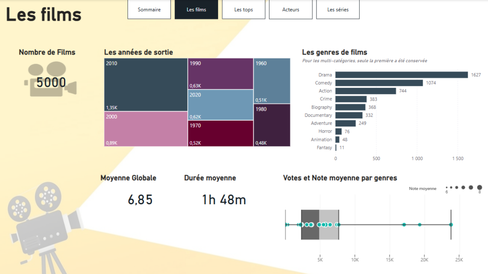
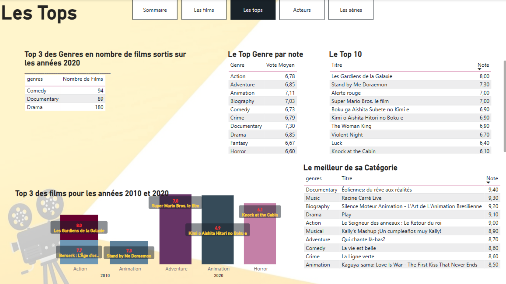
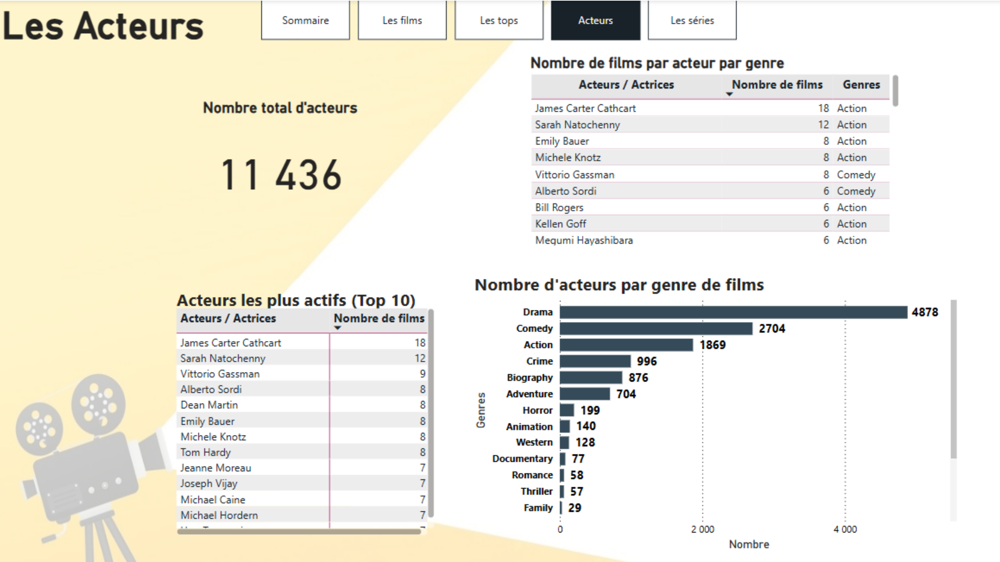
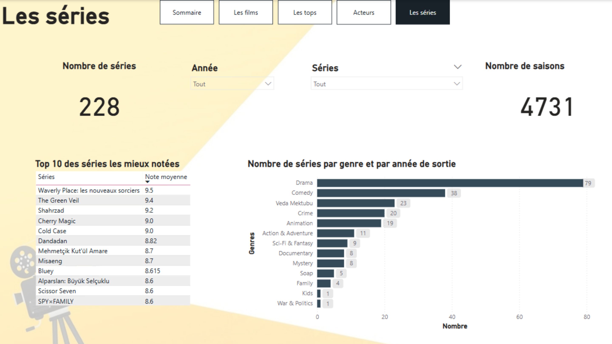
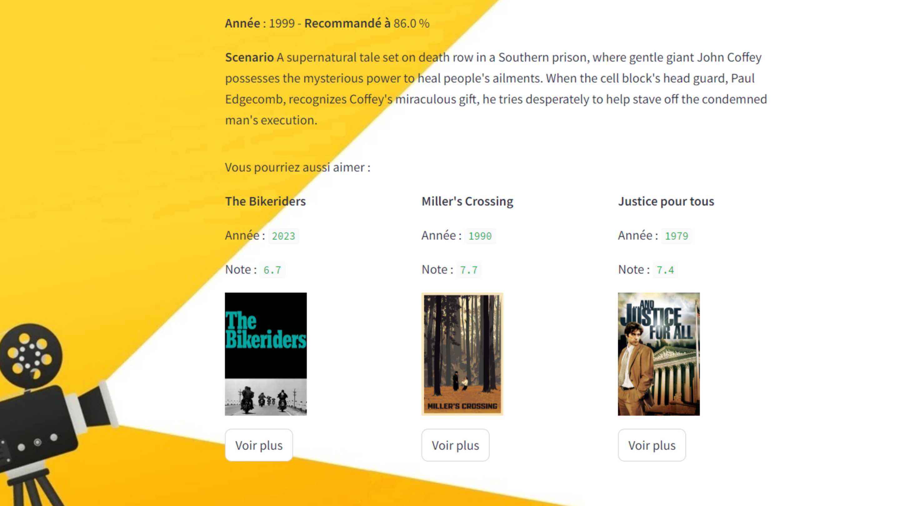

# Système de recommandation de films

Projet combinant un dashboard Power BI d'analyse de catalogue cinéma (films, acteurs, séries) et un moteur de recommandation de films basé sur le Machine Learning, exposé via une application Streamlit interactive.

**Outils utilisés** : Python (Pandas, Matplotlib, Seaborn, Scikit-learn), Power BI, Streamlit

---

## 🎬 Les films
Vue d'ensemble du catalogue (5000 films) :
- répartition des films par année de sortie
- répartition par genre (Drama, Comedy, Action...)
- note moyenne globale (6,85) et durée moyenne (1h48)
- votes et note moyenne par genre

---

## 🏆 Les tops
Classements et meilleurs films par catégorie :
- top 3 des genres les plus produits sur les années 2020
- top genre par note moyenne
- top 10 des films les mieux notés
- meilleur film de chaque catégorie

---

## 🎭 Acteurs
Analyse des acteurs et actrices du catalogue :
- 11 436 acteurs recensés
- top 10 des acteurs les plus actifs
- nombre d'acteurs par genre de films

---

## 📺 Les séries
Statistiques sur les séries (228 séries, 4731 saisons) :
- top 10 des séries les mieux notées
- répartition des séries par genre et année de sortie

---

## 🤖 Application Streamlit & Machine Learning
Application web permettant de naviguer dans le catalogue et d'obtenir des recommandations personnalisées calculées par un modèle de Machine Learning :

Exemple de recommandation générée à partir du film *La Ligne verte* (recommandé à 86 %) :

