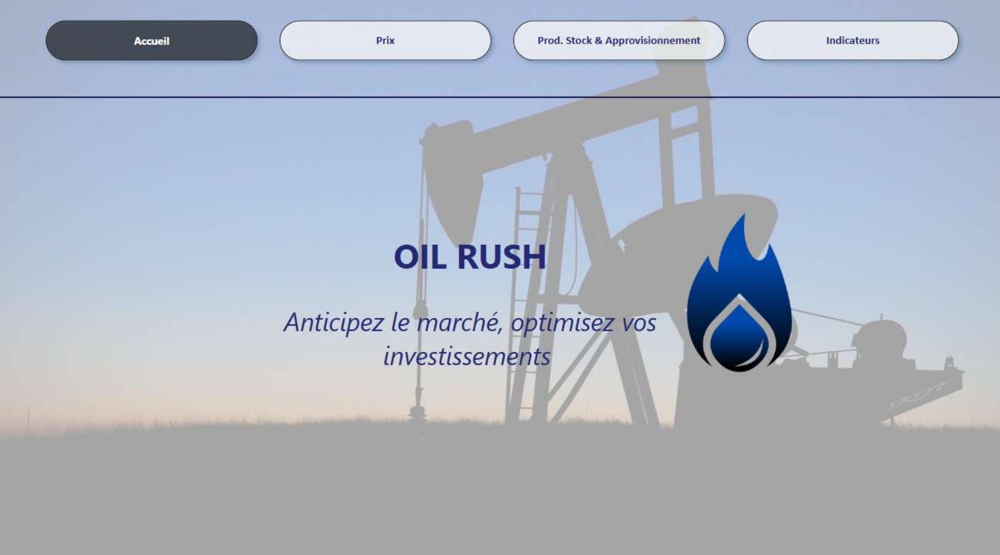
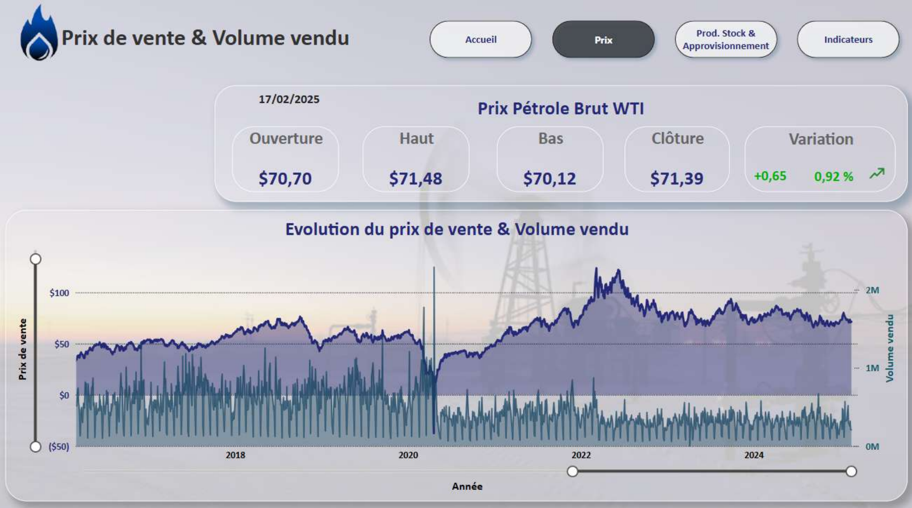
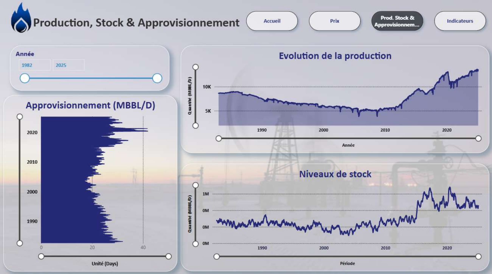
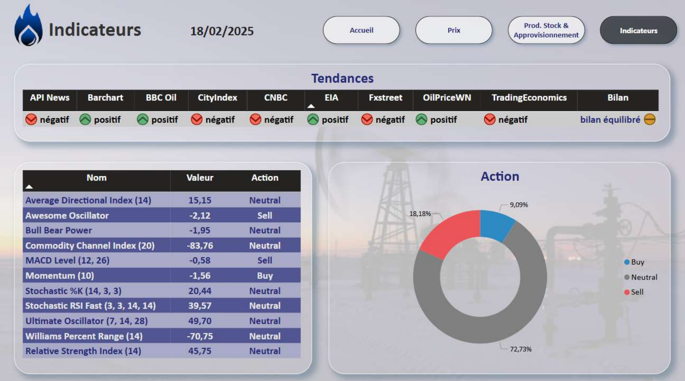

# Analyse et évolution du Pétrole WTI — "Oil Rush"

Dashboard Power BI d'aide à la décision pour anticiper le marché du pétrole brut WTI et optimiser des investissements : suivi des prix, de la production, des stocks et des indicateurs techniques de trading.

**Outils utilisés** : Power BI

---

## 💲 Prix
Suivi du prix de vente et du volume échangé du pétrole brut WTI :
- ouverture, plus haut, plus bas, clôture et variation du jour
- évolution historique du prix de vente et du volume vendu depuis 2016

---

## 🛢️ Production, Stock & Approvisionnement
Analyse de l'offre sur longue période (1982-2025) :
- évolution de la production mondiale
- niveaux de stock
- approvisionnement journalier (MBBL/D)

---

## 📈 Indicateurs
Tableau de bord d'aide à la décision basé sur des indicateurs techniques de trading :
- tendances agrégées de 9 sources d'information (API News, Barchart, BBC Oil, CNBC, EIA...)
- indicateurs techniques (RSI, MACD, Stochastic, Momentum...) et signal associé (Buy / Neutral / Sell)
- répartition globale des signaux d'action

